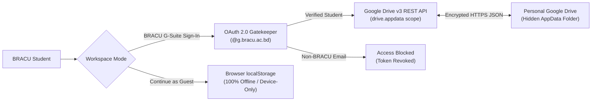

<div align="center">

<br />


# Route136

**Your BRACU CSE curriculum, engineered for clarity.**

`136 Credits` • `Pre-req Chain Engine` • `Semester Performance Charts` • `Target CGPA & Retake ROI` • `Zero-Database Google Drive Sync`

<p>
  <a href="https://nextjs.org/"></a>
  <a href="https://react.dev/"></a>
  <a href="https://www.typescriptlang.org/"></a>
  <a href="https://tailwindcss.com/"></a>
  <a href="https://developers.google.com/drive"></a>
  <a href="LICENSE"></a>
</p>

<p>
  <a href="#-overview">Overview</a> •
  <a href="#-system-capabilities">System Capabilities</a> •
  <a href="#-136-credit-curriculum-architecture">136-Credit Architecture</a> •
  <a href="#-zero-database-privacy--cloud-sync">Privacy &amp; Cloud Sync</a> •
  <a href="#-getting-started">Getting Started</a> •
  <a href="#-project-structure">Project Structure</a>
</p>

<br />

</div>

---

> **`[ route136.app/workspace ]`** — Built specifically for **BRAC University (BRACU) CSE** undergraduate students. No centralized servers, no manual spreadsheet formulas, and full client-side data sovereignty.

---

## `[ OVERVIEW ]`

Planning a **136-credit** BRACU CSE degree means juggling multi-tier prerequisite chains, 5-stream General Education (GenEd) rules, Residential Semester (`TARC`) requirements, and retake grade-replacement math.

**Route136** replaces fragile spreadsheets with a high-contrast, Vercel-inspired workspace featuring:
- A streamlined **3-Step Setup Wizard** that builds 12 semesters without auto-dumping unwanted courses into future terms.
- An interactive **Pre-req Chain Explorer** showing every CSE, MNS & BIL dependency sequence and how many courses remain.
- Real-time **Semester Performance Charts**, **Target CGPA Solver**, **Retake ROI Analyzer**, and **4K Grade Sheet PNG Snapshot** exports.

---

## `[ SYSTEM CAPABILITIES ]`

| Capability | Badge | Description |
| :--- | :--- | :--- |
| **Interactive Prerequisite Chains** | `PRE-REQ CHAIN` | Visualize every **CSE**, **MNS**, **BIL**, and **Major Elective** sequence in one flowchart. Track **`X / Y Completed • Z Left`** per chain, spot **`Ready Next`** courses, and inspect Hard (`HP`) / Soft (`SP`) prerequisites. |
| **Semester Performance Charts** | `TRAJECTORY` | Interactive term-by-term **SGPA bar chart** with an editable graduation **Target Goal** reference line (`Goal: 3.50`) in the header, peak semester highlight, and 1-click **Quick Grade Entry**. |
| **Target CGPA Solver & Retake ROI** | `TRAJECTORY ENGINE` | Compute the exact GPA required across remaining credits to hit your target CGPA, and simulate single or multi-course retakes ranked by exact cumulative CGPA boost. |
| **Multi-Semester Course Builder** | `COURSE PICKER` | Horizontal semester tab switcher (`Sem 1`, `Sem 2`, `RS`, etc.) to populate multiple semesters in one session—including **in-batch Retake / Repeat Course** confirmation across terms. |
| **3-Step Timeline Setup Wizard** | `12-SEM PLANNER` | Pick your Current Semester (`1st`–`12th`), Starting Intake, and flexible **RS placement** (including custom semester # or *Not Sure Yet*), with inline `ENG102` / `BU201` RS selection. |
| **Updated 136-Credit OBE Roadmap** | `SYLLABUS` | Color-coded **Curriculum Roadmap** aligned with the updated BRACU CSE Degree Plan—covering Program Core (with `CSE110`/`CSE260` cross-listings), School Core, 5 GenEd Streams, and 2 Free GenEd Electives. |
| **Grade Sheet PNG Snapshot** | `EXPORT` | High-resolution dark-mode transcript snapshot featuring combined **Degree Progress & CGPA**, detailed **Core/MNS/Electives/Thesis** & **GenEd** progress bars, coursework table, and developer attribution. |
| **Zero-Database Cloud Sync** | `G-SUITE` | Instant **Guest Mode** (`localStorage`) or verified **`@g.bracu.ac.bd`** Google OAuth sync strictly to your private Google Drive `appDataFolder`. |

---

## `[ 136-CREDIT CURRICULUM ARCHITECTURE ]`

Pre-configured with the official **BRACU CSE 136-Credit OBE Syllabus** (132 academic credits + 4 non-academic Capstone credits):

| Category | Required Courses | Credit Load | Key Modules &amp; Rules |
| :--- | :---: | :---: | :--- |
| **Program Core (CSE)** | 25 Courses | **75 Cr** | `CSE110` *(CSE161/EEE/ECE103)*, `CSE111`, `CSE220`, `CSE221`, `CSE230`, `CSE250`, `CSE251`, `CSE260` *(EEE/ECE283/301)*, `CSE320`–`CSE471` |
| **Program Electives** | 2 Courses | **6 Cr** | Minimum 1 CSE elective; 2nd may be CSE, COD/GenEd, Minor, or 2nd Major |
| **Project / Internship / Thesis** | 1 Course | **4 Cr** | `CSE400` (Final Year Capstone) |
| **School Core (MNS)** | 4 Courses | **12 Cr** | `MAT120`, `MAT215`, `MAT216`, `PHY112` |
| **University Core: Stream 1 (BIL)** | 2 Courses | **6 Cr** | `ENG101` + `ENG102` *(or `ENG102` + `ENG103` for ENG102 freshers; `ENG091` 0-cr support)* |
| **University Core: Stream 2 (MNS)** | 3 Courses | **9 Cr** | `MAT110`, `PHY111`, `STA201` *(+ optional `CHE101`, `BIO101`, `ENV103`, `GSC110`; `MAT092` 0-cr support)* |
| **University Core: Stream 3 (Arts)** | 3 Courses | **9 Cr** | `HUM103`, `BNG103` + min 1 from `HUM101`–`HUM301`, `HST102`–`HST104`, `ENG110`–`ENG333` |
| **University Core: Stream 4 (Social)** | 2 Courses | **6 Cr** | `EMB101` / `DEV101` + min 1 from `PSY101`, `SOC101`, `ECO101`, `POL101`, `BU201`, etc. |
| **University Core: Stream 5 (CST)** | 1 Course | **3 Cr** | Min 1 from `CST201`–`CST333`, `BUS334` |
| **GenEd Electives (Free Choice)** | 2 Courses | **6 Cr** | Any 2 courses from Streams 2–5 or outside the CSE department |
| **Total Degree Requirement** | **45 Courses** | **136 Cr** | **Full Graduation Audit &amp; Prerequisite Chain Tracking** |

---

## `[ ZERO-DATABASE PRIVACY & CLOUD SYNC ]`

Route136 runs on a **100% Client-Side Architecture**. No grades, student IDs, or academic plans are ever stored on any centralized server.



- **Domain Gatekeeper (`@g.bracu.ac.bd`)**: Google OAuth 2.0 verifies BRACU G-Suite student accounts and revokes unauthorized tokens client-side.
- **Isolated `appDataFolder` Scope**: Uses `https://www.googleapis.com/auth/drive.appdata` only—Route136 cannot view or modify your personal Drive files.
- **Guest Mode**: Works offline out of the box with `.json` export/restore backups.

---

## `[ GETTING STARTED ]`

```bash
# 1. Clone the repository
git clone https://github.com/fakekhanabdullah/Route136-CSE-Course-Tracker.git
cd "Route136 CSE Course Tracker"

# 2. Install dependencies
npm install

# 3. (Optional) Configure Google OAuth Client ID for local Drive sync
echo "NEXT_PUBLIC_GOOGLE_CLIENT_ID=your-client-id.apps.googleusercontent.com" > .env.local

# 4. Run development server
npm run dev

# 5. Build for production
npm run build && npm start
```

Open [http://localhost:3000](http://localhost:3000) in your browser.

---

## `[ PROJECT STRUCTURE ]`

```text
Route136-CSE-Course-Tracker/
├── public/
│   ├── icon.svg                           # White browser tab favicon (32x32 SVG)
│   ├── logo-white.svg                     # Route136 white logo (400x400 SVG)
│   ├── logo-white.png                     # Route136 white logo (400x400 PNG)
│   ├── manifest.json                      # PWA manifest metadata
│   └── sw.js                              # Service worker for offline caching
├── src/
│   ├── app/
│   │   ├── courses-data.ts                # 136-credit BRACU CSE course catalog & prerequisites
│   │   ├── globals.css                    # Tailwind CSS v4 tokens, Vercel shadows & scrollbars
│   │   ├── icon.svg                       # Next.js App Router white favicon
│   │   ├── layout.tsx                     # Root layout, Geist fonts, theme hydration & metadata
│   │   ├── page.tsx                       # Landing page, 3-step setup wizard, workspace & modals
│   │   ├── privacy/page.tsx               # Privacy Policy (dark/light persisted)
│   │   └── terms/page.tsx                 # Terms of Service (dark/light persisted)
│   ├── components/
│   │   ├── AddCoursesModal.tsx            # Multi-semester course builder with in-batch retakes
│   │   ├── AddSemesterModal.tsx           # Focused semester editor modal
│   │   ├── CgpaSemesterGraph.tsx          # Semester performance SGPA chart + editable goal
│   │   ├── MobileBottomNav.tsx            # Responsive mobile navigation dock
│   │   ├── PrereqChainsModal.tsx          # Interactive CSE/MNS/BIL prerequisite chain viewer
│   │   ├── QuickGradeCarouselModal.tsx    # Term-by-term carousel for rapid grade entry
│   │   ├── SpeedDialMenu.tsx              # Mobile quick-action sheet
│   │   └── ThemeToggleButton.tsx          # Shared Dark/Light theme switcher
│   └── lib/
│       └── googleDriveSync.ts             # Google OAuth 2.0 gatekeeper & Drive v3 AppData client
├── package.json                           # Next.js 16.4.6, React 19.2.4, Tailwind CSS v4
└── tsconfig.json                          # Strict TypeScript configuration
```

---

## `[ DISCLAIMER & LICENSE ]`

- **Academic Disclaimer**: **Route136** is an independent, student-built open-source utility created by [Khan Abdullah](https://github.com/fakekhanabdullah) and is **not officially affiliated with, endorsed by, or operated by BRAC University**. All official academic records, prerequisite clearances, and graduation audits are governed exclusively by BRAC University's Office of the Registrar, USIS/Connect portals, and departmental advisors.
- **Curriculum Attribution**: Recommended 136-credit degree distribution guidelines incorporate reference materials compiled by **Badhon Nandi** (FYAT Mentor, OAA, BRAC University).
- **License**: Distributed under the [MIT License](LICENSE).

---

<div align="center">
  <sub>Built for the BRACU CSE Community by <a href="https://github.com/fakekhanabdullah">Khan Abdullah</a> • Powered by Next.js 16 &amp; Tailwind CSS v4</sub>
</div>
